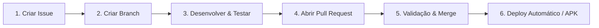

# Diretrizes de Desenvolvimento e Contribuição — CineBG

Este documento estabelece as **regras obrigatórias de governança de código e ciclo de vida de desenvolvimento** do projeto **CineBG**. Todos os colaboradores e **qualquer Agente de IA (independente do modelo ou plataforma)** devem seguir estritamente este padrão operacional.

---

## 📌 Regra Fundamental: GitHub Flow com Issues e PRs

> **Nenhuma alteração de código (Correção, Melhoria ou Nova Função) deve ser mesclada diretamente na branch principal (`main`).**

Todo o ciclo de entrega é gerenciado pelo fluxo:


---

## 1. Classificação e Criação de Issues

Antes de escrever qualquer código, **uma Issue deve ser aberta no GitHub** contendo uma das seguintes classificações no título e labels:

| Tipo | Prefixo | Descrição | Exemplo |
| :--- | :--- | :--- | :--- |
| **Correção (Bug Fix)** | `fix:` | Resolução de comportamentos incorretos, erros de runtime, falhas de player ou redirects. | `fix: isolar iframe com sandbox para bloquear popups da ParkLogic` |
| **Melhoria (Improvement)** | `perf:` ou `refactor:` | Otimização de performance, refinamento de UX, arquitetura ou fallback de servidores. | `perf: cascata de fallback silencioso estilo YuCine` |
| **Nova Função (Feature)** | `feat:` | Implementação de novos recursos, telas, suporte a novos dispositivos ou integrações. | `feat: suporte a controle remoto espacial em Android TV` |

### Estrutura Obrigatória da Issue:
1. **Contexto / Problema**: O que está ocorrendo ou qual a oportunidade.
2. **Comportamento Esperado**: O que deve acontecer após a conclusão.
3. **Critérios de Aceite**: Itens verificáveis para considerar a tarefa concluída.

---

## 2. Padrão de Nomenclatura de Branches

Toda branch deve ser criada a partir da `main` atualizada, utilizando a referência da issue:
* Para correções: `fix/issue-<numero>-<descricao-curta>`
* Para melhorias: `improvement/issue-<numero>-<descricao-curta>`
* Para novas funções: `feature/issue-<numero>-<descricao-curta>`

Exemplos:
```bash
git checkout -b fix/issue-1-sandbox-anti-redirect
git checkout -b feature/issue-2-multiaudio-yucine
```

---

## 3. Gestão de Deploys via Pull Requests (PRs)

O deploy e a validação de novas versões em produção (Web e APK Android) são controlados exclusivamente através da aprovação e merge de Pull Requests.

### Regra Crítica de Descrição do PR:
Todo PR **DEVE obrigatoriamente referenciar e encerrar a Issue associada** utilizando as palavras-chave oficiais do GitHub:
* `Fixes #<NUMERO_DA_ISSUE>` (para correções)
* `Closes #<NUMERO_DA_ISSUE>` (para melhorias ou tarefas)
* `Resolves #<NUMERO_DA_ISSUE>` (para novas funcionalidades)

#### Modelo de Descrição do PR:
```markdown
## Descrição das Alterações
Resumo objetivo das mudanças implementadas.

## Issue Relacionada
Fixes #<NUMERO_DA_ISSUE> (ou Closes #<NUMERO_DA_ISSUE>)

## Tipo de Mudança
- [ ] Correção de Bug (fix)
- [ ] Melhoria de Performance / UX (improvement)
- [ ] Nova Funcionalidade (feature)

## Checklist de Validação
- [ ] Testes de compilação executados com sucesso (`npm run build`).
- [ ] Testes manuais no player de vídeo realizados.
- [ ] Zero erros de linter ou tipagem TypeScript (`npx tsc --noEmit`).
```

---

## 4. Diretrizes para Agentes de IA

Quando um Agente de IA estiver atuando no projeto:
1. **Identificar ou Criar a Issue**: Certifique-se de que a demanda possui uma Issue registrada ou registre-a antes de iniciar as alterações.
2. **Desenvolver no Branch Apropriado**: Isole as modificações sem poluir a branch de produção.
3. **Validar com Build Limpo**: Execute sempre `npm run build` e `npx tsc --noEmit` antes de propor ou abrir o PR.
4. **Mencionar a Issue no PR**: Garanta que o corpo do Pull Request possua a cláusula de fechamento (`Closes #X` ou `Fixes #X`).
